# 🦟 Malaria Detection with Deep Learning: Applied AI Capstone

[](https://www.python.org/)
[](https://www.tensorflow.org/)
[](https://opencv.org/)
[]()

---

## 📋 Project Overview

This project was developed as the **Capstone Project (Deep Learning)** of the **MIT Professional Education – Applied AI & Data Science Program**.

It uses Convolutional Neural Networks (CNNs) to automatically classify microscopic images of red blood cells as **Parasitized** (infected with *Plasmodium*) or **Uninfected**, aiming to reduce manual work, lower human error, and speed up malaria diagnosis.

---

## 🎯 Objective

Build and compare several deep learning models for binary image classification, prioritizing **recall on the Parasitized class**, since a missed malaria case (false negative) is clinically more dangerous than an unnecessary follow-up (false positive).

---

## 📊 Dataset

Colored PNG images of single red blood cells, split into train and test sets (provided by the program as `cell_images.zip`; **not included in this repo**).

| Split | Parasitized | Uninfected | Total |
|-------|------------:|-----------:|------:|
| Train (full dataset) | 12,376 | 12,582 | 24,958 |
| Train (stratified subsample used for training) | 4,000 | 4,000 | 8,000 |
| Test | 1,300 | 1,300 | 2,600 |

- Images resized to **64 × 64 × 3** and normalized to **[0, 1]**
- Classes are balanced (~50/50), so accuracy is a reliable metric
- Images are already cropped at single-cell level, so no detection or segmentation is needed
- A balanced 8,000-image subsample was used to keep training tractable on Colab

---

## 🔍 Exploratory Data Analysis

### ⚖️ Class Distribution
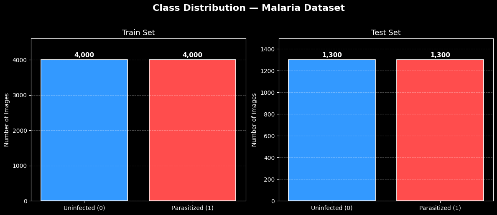

### 🔬 Sample Cells
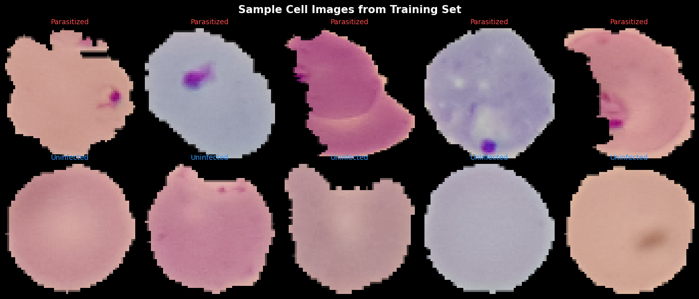

### 🧪 Mean Image per Class
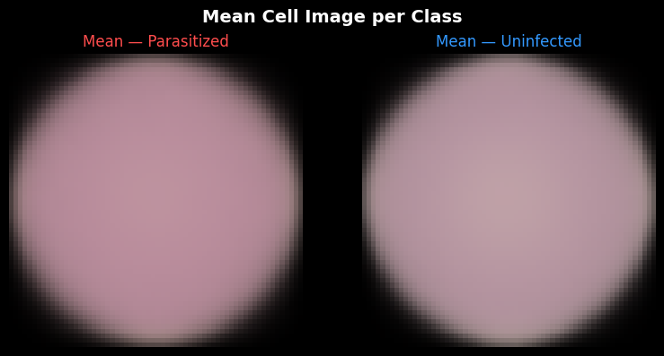

### 🎨 RGB vs HSV
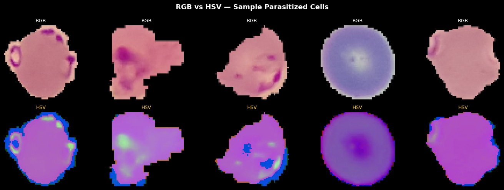

### 🌫️ Gaussian Blur
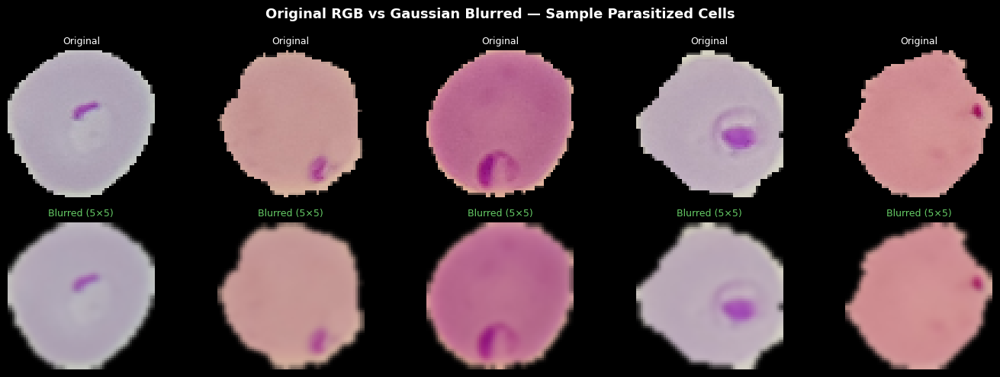

> Blurring softens the sharp edges of parasite inclusions, which are the features that separate the classes, so it was **not** used in the final pipeline.

---

## 🤖 Models Implemented

| # | Model | Description |
|---|-------|-------------|
| 0 | **Base CNN** | 3 conv blocks (Conv → ReLU → MaxPool) + Dense(256) + Dropout(0.4) |
| 1 | **Model 1: Deeper CNN** | 4 conv blocks + larger dense head with dropout |
| 2 | **Model 2: BatchNorm + LeakyReLU** | Batch Normalization and LeakyReLU (α = 0.1) in every block |
| 3 | **Model 3: Data Augmentation** | Model 2 architecture + rotations, flips, shifts and zoom |
| 4 | **VGG16 Transfer Learning** | Frozen ImageNet VGG16 base + custom dense head |

All models use `categorical_crossentropy` (2-unit softmax), Adam, `EarlyStopping` and `ReduceLROnPlateau`.

### 🔄 Data Augmentation
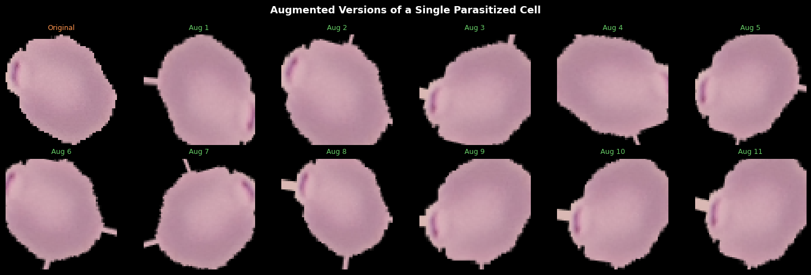

---

## 📈 Model Comparison (Test Set, 2,600 images)

| Model | Accuracy | Precision (Parasitized) | Recall (Parasitized) | F1 (Parasitized) |
|-------|---------:|------------------------:|---------------------:|-----------------:|
| Base CNN | **0.9785** | 0.99 | 0.96 | 0.98 |
| Model 1: Deeper CNN | **0.9785** | 0.99 | 0.97 | 0.98 |
| Model 2: BatchNorm + LeakyReLU | 0.9081 | 1.00 | 0.82 | 0.90 |
| Model 3: Augmentation | 0.9738 | 0.96 | **0.99** | 0.97 |
| VGG16 Transfer Learning | 0.9377 | 0.94 | 0.94 | 0.94 |

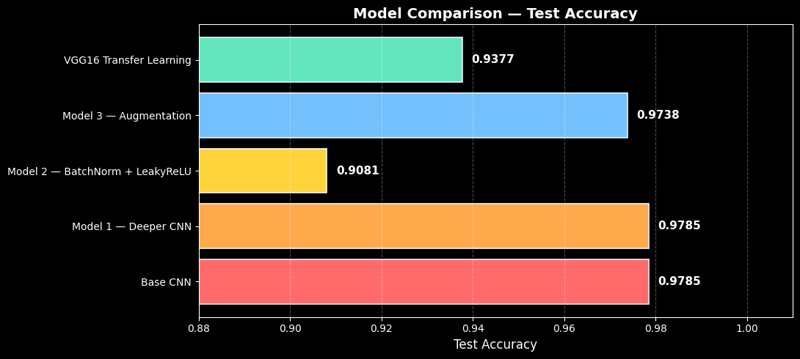

### Training curves and confusion matrices

| Base CNN | Model 1: Deeper CNN |
|:--:|:--:|
| 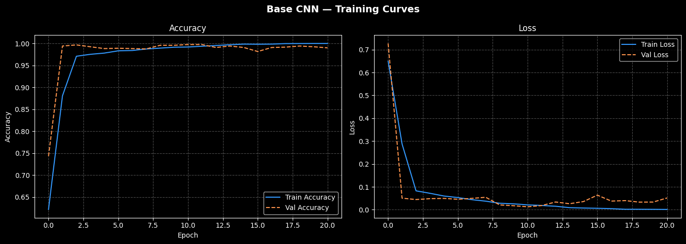 | 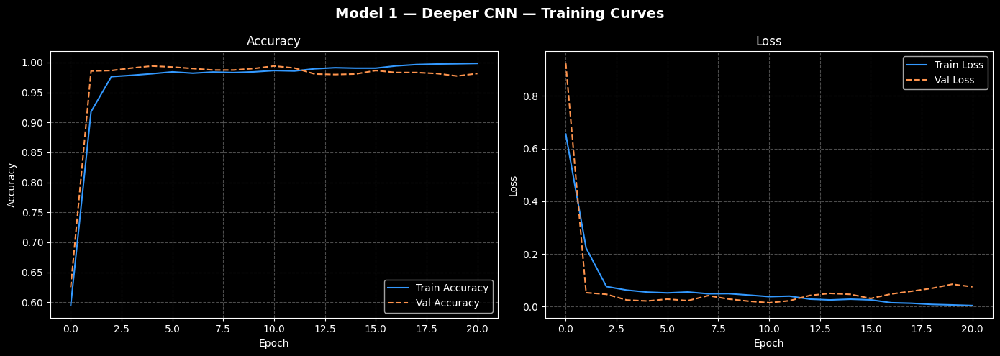 |
| 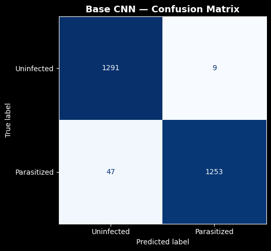 | 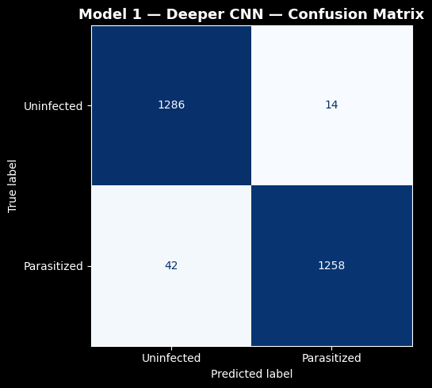 |

| Model 2: BN + LeakyReLU | Model 3: Augmentation |
|:--:|:--:|
| 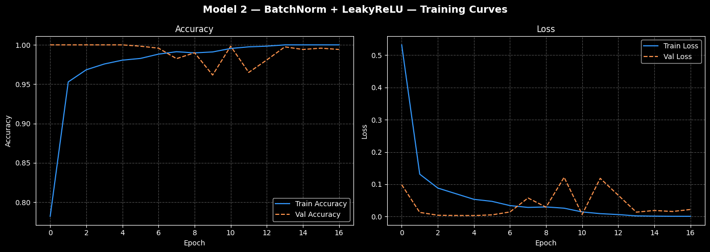 | 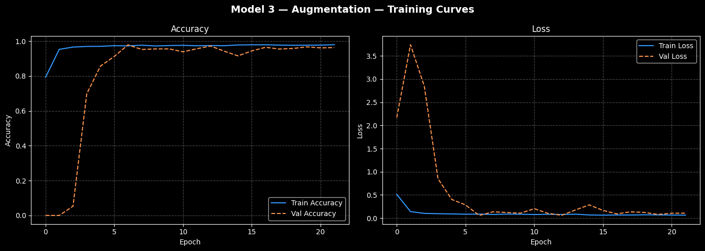 |
| 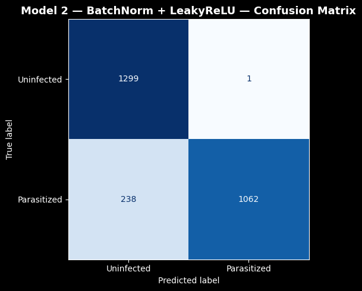 | 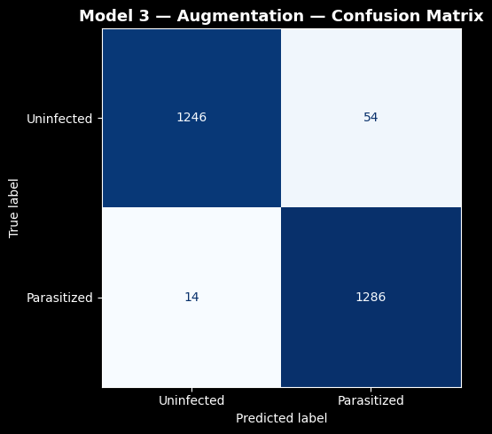 |

| VGG16 Transfer Learning |
|:--:|
| 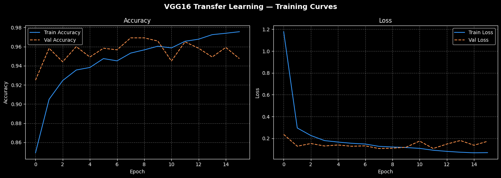 |
| 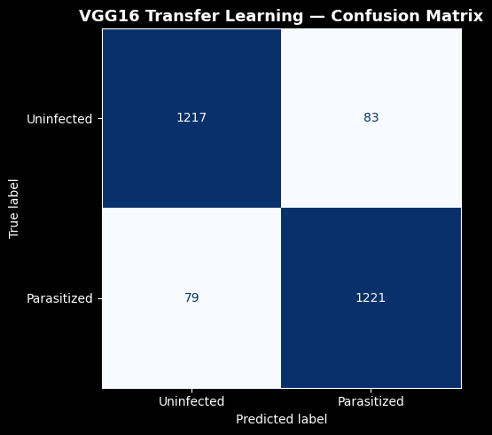 |

---

## 🏆 Key Results

- The visual difference between parasitized and uninfected cells is highly learnable: even a small CNN reaches **~98% accuracy**
- **Base CNN** and **Deeper CNN** tie on accuracy (97.85%)
- **Model 3 (augmentation)** has the **highest Parasitized recall (0.99)**, the key clinical metric, making it a strong candidate for a screening setting
- **VGG16** (frozen, 64 × 64 inputs) underperformed the custom CNNs: ImageNet features are not tuned to microscopy and the small input size limits its feature maps
- **Model 2** reached high precision but missed many infected cells (recall 0.82), so it is not suitable for screening as-is

---

## ⚠️ Limitations

- Single dataset and a single train/test split; no cross-lab or cross-stain validation
- Training on an 8,000-image subsample rather than the full 24,958 images
- Results are from a research exercise and **not a validated clinical tool**; any real deployment would need human review and prospective clinical validation

---

## 🚀 Future Improvements

- Fine-tune the last VGG16 block (`block5`) with a low learning rate
- Try EfficientNet / ResNet and higher input resolution
- Grad-CAM to inspect which regions drive each prediction
- Train on the full dataset and evaluate across staining protocols
- Test-time augmentation and RGB + HSV ensembles

---

## 🛠️ Tech Stack

Python · TensorFlow / Keras · OpenCV · NumPy · Pandas · Matplotlib · Seaborn · scikit-learn · Google Colab (GPU)

---

## 📁 Repository Structure

```
.
├── Gabriela_Vidales_Malaria_Detection.ipynb   # Full solution notebook
├── images/                                    # Figures exported from the notebook
├── requirements.txt
├── LICENSE
└── README.md
```

---

## ▶️ How to Run

1. Clone the repo:
   ```bash
   git clone https://github.com/<your-username>/Malaria-Detection-Deep-Learning.git
   cd Malaria-Detection-Deep-Learning
   pip install -r requirements.txt
   ```
2. Obtain `cell_images.zip` (the capstone dataset) and place it in your Google Drive or working directory.
3. Open the notebook in **Google Colab** (GPU runtime recommended) and update the dataset paths in the *Mount Google Drive* and *Dataset Setup* cells.
4. Run all cells top to bottom.

---

## 👩‍💻 Author

**Gabriela Yasmin Vidales Ayala**
MIT Professional Education: Applied AI & Data Science Program (January 2026 – June 2026)
🔗 [LinkedIn](https://www.linkedin.com/in/gabriela-vidales)
